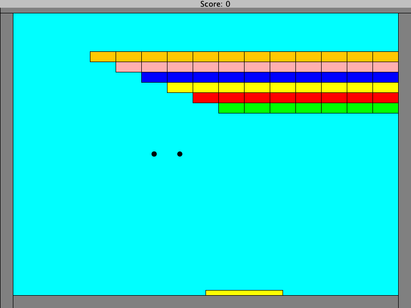
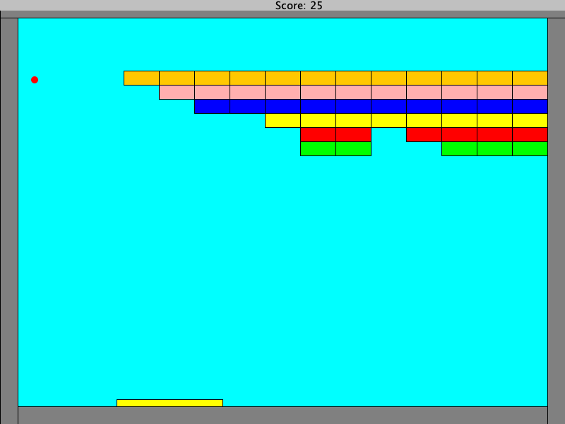
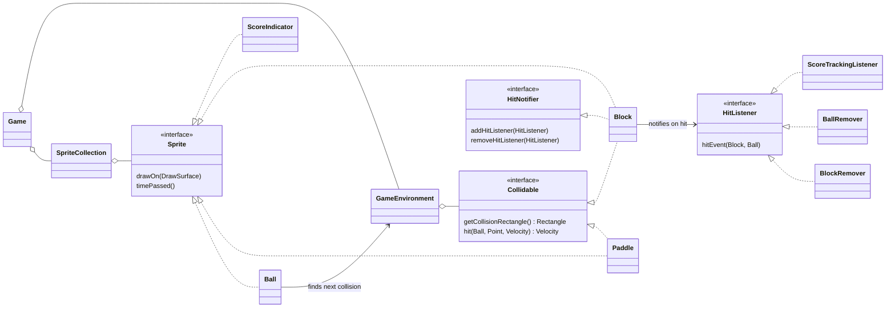
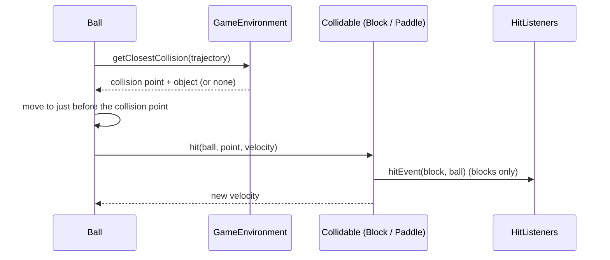

# Arkanoid

A Java version of the classic **Arkanoid** brick-breaker: three balls, a paddle, and a staircase of 57 colored blocks to clear. Built for the Object-Oriented Programming course at Bar-Ilan University, using the course's `biuoop` graphics library, with an emphasis on object-oriented design: interfaces, polymorphism and the Observer pattern.

<p align="center">
  
</p>

| Start of the game | During the game |
|---|---|
|  |  |

## Contents

- [How to play](#how-to-play)
- [Run it](#run-it)
- [Architecture](#architecture)
  - [Packages](#packages)
  - [Core interfaces](#core-interfaces)
  - [The game loop](#the-game-loop)
  - [Collision detection](#collision-detection)
  - [Hit events: the Observer pattern](#hit-events-the-observer-pattern)
  - [The paddle](#the-paddle)
- [Game constants](#game-constants)
- [Project structure](#project-structure)

## How to play

| Key | Action |
|---|---|
| ← | Move the paddle left |
| → | Move the paddle right |

- The game starts with **three balls** flying in random directions.
- Break blocks by hitting them with a ball. Each block is worth **5 points**, and clearing all 57 blocks adds a **100-point bonus**.
- When a ball breaks a block, the ball **takes on that block's color**. A ball can't break a block of its own color; it just bounces off. You often need to hit a different color first.
- Where the ball lands on the paddle sets its new direction (see [The paddle](#the-paddle)).
- The paddle wraps around: move past one edge and it reappears on the other side.
- A ball that falls past the paddle is lost. The game ends, and the window closes, when all blocks are cleared or all three balls are lost.

## Run it

Requires a Java JDK (11 or newer) and [Apache Ant](https://ant.apache.org).

```bash
ant -f "base files/build.xml" run
```

`compile` builds the classes into `bin/`, and `clean` removes them.

Without Ant:

```bash
javac -d bin -cp "base files/biuoop-1.4.jar" Ass5Game.java */*.java
java -cp "bin:base files/biuoop-1.4.jar" Ass5Game
```

On Windows, use `;` instead of `:` in the classpath.

## Architecture

### Packages

| Package | Responsibility | Main classes |
|---|---|---|
| `gameSetup` | Builds the level and runs the game loop | `Game`, `GameEnvironment`, `SpriteCollection` |
| `gameObjects` | Everything that lives in the game | `Ball`, `Paddle`, `Block`, `Velocity`, `Counter`, `ScoreIndicator`, the hit listeners |
| `gameInterfaces` | The contracts that tie it together | `Sprite`, `Collidable`, `HitListener`, `HitNotifier` |
| `geometryObjects` | Pure geometry, no game logic | `Point`, `Line`, `Rectangle` |

`Ass5Game` is the entry point: it creates a `Game`, calls `initialize()` and then `run()`.

### Core interfaces

The game never asks *what kind* of object it is dealing with. It only relies on these interfaces, so new kinds of objects can be added without changing the loop or the collision code.



| Interface | Meaning | Implemented by |
|---|---|---|
| `Sprite` | Can draw itself and update once per frame | `Ball`, `Paddle`, `Block`, `ScoreIndicator` |
| `Collidable` | A ball can bounce off it; decides the ball's new velocity | `Paddle`, `Block` |
| `HitNotifier` | Announces when it is hit | `Block` |
| `HitListener` | Reacts when a block is hit | `BlockRemover`, `BallRemover`, `ScoreTrackingListener` |

A `Block` is used for everything rectangular: the gray borders, the bottom "death region", the background and the 57 breakable blocks. What makes them behave differently is only which listeners are attached to them.

### The game loop

`Game.run()` runs at 60 frames per second:

1. Draw every sprite on a fresh frame and show it.
2. Call `timePassed()` on every sprite. Balls move, and the paddle reads the keyboard.
3. Sleep for whatever is left of the frame's 1/60 second.
4. Stop when no blocks are left (adding the 100-point bonus) or no balls are left.

`SpriteCollection` iterates over a **copy** of its list. Objects can be removed in the middle of a frame (a broken block, a lost ball) without breaking the loop.

### Collision detection

Each frame, a ball moves by its velocity `(dx, dy)`. Before it moves:

1. The ball builds its **trajectory**: the line from its center to where it would end up this frame.
2. `GameEnvironment.getClosestCollision(trajectory)` checks every collidable. Each collision rectangle is four lines (`Rectangle.intersectionPoints`), and the nearest intersection to the start of the trajectory wins.
3. **No collision:** the ball simply moves to the end of the trajectory.
4. **Collision:** the ball moves to just before the collision point (backing off by 20% of its velocity and nudging 1 pixel away from the edge it hit), so it never ends up inside an object. Then it calls the object's `hit(...)`, which returns the new velocity.



For a `Block`, the new velocity depends on which edge was hit: a left or right edge reverses `dx`, a top or bottom edge reverses `dy`, and a corner reverses both. All comparisons between doubles use a small tolerance (`ConstantVariables.EPSILON = 0.00001`) to avoid floating-point surprises.

### Hit events: the Observer pattern

Blocks don't know about scores or counters. When a ball hits a block of a **different** color, the block:

1. recolors the ball to its own color (except for the gray borders);
2. notifies every registered `HitListener`.

When the colors match, the ball just bounces and nothing else happens.

What happens next depends entirely on which listeners `Game.initialize()` attached:

| Listener | Attached to | On hit |
|---|---|---|
| `BlockRemover` | the 57 breakable blocks | removes the block from the game and decrements the blocks counter |
| `ScoreTrackingListener` | the 57 breakable blocks | adds 5 points to the score |
| `BallRemover` | the death region below the paddle | removes the ball and decrements the balls counter |

The game ends by watching two `Counter`s (blocks left, balls left), and `ScoreIndicator` draws a third (the score) at the top of the screen. The loop and the listeners never call each other directly.

Listeners are notified from a copy of the listener list, so a listener can safely unregister itself while it is being called.

### The paddle

The paddle is split into five equal zones. A ball landing on it leaves at an angle set by the zone it hits, which lets the player aim:

| Zone | 1 (left) | 2 | 3 (middle) | 4 | 5 (right) |
|---|---|---|---|---|---|
| New direction | 60° left of up | 30° left of up | reflected straight back up | 30° right of up | 60° right of up |

Hitting the paddle's side edges only reverses the horizontal direction. Speed is always preserved.

Directions use one convention throughout: **0° is straight up**, and `Velocity.fromAngleAndSpeed(angle, speed)` gives `dx = speed·sin(angle)` and `dy = −speed·cos(angle)`.

## Game constants

| What | Value |
|---|---|
| Window | 800 × 600, title "Arkanoid" |
| Play area | 750 × 550 (inside 25-pixel gray borders) |
| Frame rate | 60 frames per second |
| Balls | 3, radius 5, speed 5 pixels per frame, random start direction |
| Paddle | 150 × 10 at the bottom, moves 5 pixels per frame |
| Blocks | 50 × 20, six rows of 12, 11, 10, 9, 8 and 7 blocks (57 total), aligned to the right |
| Row colors (top to bottom) | orange, pink, blue, yellow, red, green |
| Score | 5 points per block, +100 for clearing them all |

## Project structure

```
.
├── Ass5Game.java              Entry point
├── gameSetup/
│   ├── Game.java              Level setup and the game loop
│   ├── GameEnvironment.java   Collidables; finds the closest collision
│   └── SpriteCollection.java  Sprites; draws and updates them each frame
├── gameObjects/
│   ├── Ball.java              Movement and collision handling
│   ├── Paddle.java            Keyboard control and the five-zone bounce
│   ├── Block.java             Bounce, recoloring, hit notification
│   ├── Velocity.java          (dx, dy), angle and speed conversions
│   ├── CollisionInfo.java     Collision point + object
│   ├── BlockRemover.java      Hit listener: removes broken blocks
│   ├── BallRemover.java       Hit listener: removes lost balls
│   ├── ScoreTrackingListener.java  Hit listener: +5 per block
│   ├── ScoreIndicator.java    Draws the score bar
│   ├── Counter.java           Shared counter (blocks, balls, score)
│   └── ConstantVariables.java EPSILON and double comparison
├── gameInterfaces/            Sprite, Collidable, HitListener, HitNotifier
├── geometryObjects/           Point, Line, Rectangle
├── base files/
│   ├── build.xml              Ant build: compile, run, clean
│   ├── biuoop-1.4.jar         Course graphics and keyboard library
│   └── biuoop.xml             Checkstyle rules used in the course
└── docs/screenshots/          Images used in this README
```

## Author

Jonathan Hadar ([@JonHadar](https://github.com/JonHadar))
